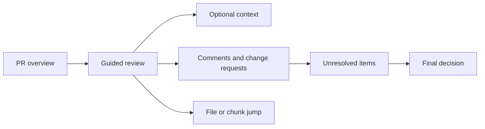

# Design note

## UI design

### PR review

The review experience is a guided terminal UI. It explains the intent of a
pull request before showing its implementation, then presents the changes in
small, meaningful units.

The design follows four principles:

- Explain intent before mechanics.
- Keep each code view within one comfortable terminal viewport.
- Show supporting context only when it improves understanding.
- Order changes for comprehension, not merely by file path.
- Connect each part to what the change claims, with numbers a reviewer can
  check, and say what it costs.

#### Claims and explainers

A walkthrough that names functions and line ranges tells the reviewer where
things are, not why the change is better. When the author's description
(`.gewu/description.md`, a pull request's title and body) claims an effect —
faster, smaller, fixed — each section says which claim it serves, and the
chunk that delivers it says how and by how much.

Explainers make that argument checkable. They are typed `content` blocks the
agent fills with data and Gewu draws (`gewu_review::Explainer`); the agent
never writes markup, so they render safely and the harness can check them:

- `claim`: a sentence quoted word for word from the description, an optional
  measured result, and how this chunk serves it. A claim not found in the
  description, or any claim when there is none, is rejected.
- `layout`: records drawn to scale, field by field, so dropped or shrunk
  fields are visible; sizes come from the code, with their source named.
- `cost_model`: whole-number parameters the reviewer drags and series whose
  formulas use only arithmetic, `log2`, `ceil`, `floor`, `min`, `max`, and
  `next_pow2` (`explainer::formula`). Each series must be finite and not
  negative across its parameters' range. The desktop app recomputes as the
  slider moves; the terminal shows the values at the defaults.

#### Review flow

The default path is linear: overview, review chunks, unresolved feedback, and
final decision. The user can jump to another file or chunk without losing
their place in the guided sequence.

#### 1. Overview

The first screen answers, “What does this PR do?” It contains:

- A one-sentence statement of intent.
- Three to five concise behavioral changes.
- Review scope, such as files changed and additions/deletions.
- New concepts or abstractions, only when the PR introduces them.
- A clear action to start the guided review.

When an illustration would make the change easier to understand, the overview
uses the smallest useful form:

- A before/after example for changed behavior or APIs.
- A short flow for changed control or data movement, drawn as a flowchart.
- A concrete input/output example for a new capability.
- A Mermaid diagram when the parts branch or call each other: `flowchart`,
  `sequenceDiagram`, `classDiagram`, or `stateDiagram-v2`. The desktop app
  draws it. The terminal shows the source. ASCII art is not a diagram.

The illustration should clarify the change rather than repeat the summary.
Routine changes do not need one.

#### 2. Guided review

The review is divided into semantic chunks. A chunk groups edits that serve
one purpose, even when those edits cross file boundaries. Git hunks are source
material, not the unit presented to the user.

Chunks are ordered by comprehension dependency:

1. New concepts, types, or interfaces.
2. Code that consumes those definitions.
3. Integration and wiring.
4. Tests and supporting changes.

Each chunk contains:

- A short title that names its purpose.
- A lean “What this does” summary.
- An ordered sequence of blocks: prose that makes a point, and the few quoted
  lines that support it, alternating as often as the explanation needs.
- Its position in the review and review status.
- Feedback actions.

The summary describes observable intent and avoids narrating individual lines.
It should normally be one or two sentences.

Quoted source is framed by a gutter and labelled with its path and
presentation, so the reviewer never has to guess where Gewu's explanation ends
and the reviewed material begins. Code quotes carry their new-side file line
numbers.

When the quoted code is something a person judges by looking — a color, a
diagram, a drawing function, a rendered document — the quote shows that result
beside the source. A picture that was never committed still counts. A library
draws nothing by itself, so the step is shown through a small example of what
is on screen: the named colors, or a call to the function the step is about.
An empty page is not that example, and neither is a frame that cuts the example off. The reviewer has to see the whole result. The page's own white fill is not part of that result when it covers only some of the marks; those marks sit on the preview surface instead of on a patch of paper.

The generated spec chooses the presentation that best supports review:

- Use a diff when removed-versus-added behavior matters. Added diff lines use a
  green background.
- Show syntax-highlighted added code without diff markers when reviewing a new
  implementation and the removed side adds no useful context.
- Render Markdown sections as documents while retaining source line numbers and
  visible code-block boundaries; raw source remains available as a toggle.
- Summarize generated artifacts whose full contents are not useful to inspect.

##### Chunk size

A chunk is the unit the user comments on, so it is sized to be worth one
comment: closely related edits only, small enough that the reviewer reacts to
the whole thing rather than to a line buried inside it. It should fit one
terminal viewport without paging.

Generation holds chunks to a row budget measured against how the review UI
draws them at a reference width. The budget defaults to one modest viewport and
is carried in the review input, so a user who deliberately wants larger chunks
can raise it when starting the harness.

A chunk quotes spans of a hunk that the agent chose, not fragments a splitter
cut in advance. Where a view begins and ends belongs to the explanation: a
thirty-line hunk becomes as many views as the walkthrough needs, each introduced
by prose saying what to look for. That prose is shown beside the view whose
lines it names, not as one paragraph above a stack of diffs. A sentence that
names several ranges is split, one note per view, so each block says how to
read it.

Views may overlap. Showing lines 1-25, then lines 10-50, repeats the middle on
purpose, because the reader needs the earlier context again to follow what
comes next. The rule is not that each line appears once — it is that the union
of everything shown covers the whole diff, so nothing goes unreviewed. Blank
lines and the unchanged context Git adds at a hunk's edges are exempt: they
belong to the code around the change, not to it.

If one semantic unit is too large, it is split at a logical boundary. Split
chunks retain a shared title and show their relationship, for example:

> Request validation · 1 of 2

Splitting must not separate a definition from the minimum context needed to
understand it. A unit that is read as a whole — a single test, a function with
its doc comment, a table — stays one chunk even when it exceeds the budget,
with an `oversized_reason` naming the unit. The reader then pages through it,
so the terminal UI must keep them oriented: every page shows where it is in the
chunk, every row is reachable by paging, no page ends on a label whose content
is on the next, and a page that opens on code pins the first sentence of the
paragraph that introduced it.

The reference terminal is 120×40, where a chunk within budget fits one screen.
80×24 is supported as a degraded mode: a chunk pages, and the pinned sentence
keeps its explanation in view. Unrelated edits must not be combined merely to fill the
viewport.

##### Refactors

When a chunk is primarily a refactor, its summary states:

- What structure changed.
- Why the change was made.
- Whether behavior is intended to remain unchanged.

A small before/after representation may be shown when it communicates the
structural change more clearly than prose.

##### A new representation of an existing structure

When a chunk's point is a new form of something the repository already had —
a data type, an encoding, a stored word, a codec — the reviewer sees both
shapes. The prose says what the earlier definition stored, what the new one
stores, which fields were dropped, packed, or added, and which of those
differences earns a property the chunk claims, such as being more compact.
It also says, in a sentence of its own, why the change was wanted: the caller,
test, or document that motivates it, or — when the repository does not say —
what the new form enables, with the open question marked as one.
The earlier definition stays on the page with the new one: in the diff, when
the removal is part of the quoted change, or in the context pane when the
quote shows only the new definition. That definition is the old structure
with its fields; a type alias that keeps the old name says what the name means
now, not what it held. A title that names the property, and prose that
restates the new fields, does not do this.

#### 3. Context pane

A right-side context pane appears only when the current chunk benefits from
supporting information. When absent, the diff uses the full available width.
The pane stays anchored at its title while the main review body scrolls, so a
resize or page movement cannot turn an example into an unlabeled fragment.

For a new or potentially unfamiliar concept, the pane shows:

- A brief definition in the context of this PR.
- A minimal example.
- Its relationship to the current chunk.

For a refactor, the pane may show:

- The previous structure.
- The new structure.
- The reason for the transition.

When the chunk replaces or redefines a structure and the quote shows only
the new definition, the pane is that side reference: the previous definition,
the new one, and the difference between them. Both definitions are on the
page from the start, laid out one field per line when the source arrived as a
single line. A field the reason names that the new definition drops is marked
in the old code. The pane is wide enough to read a signature and can be
dragged wider or narrower; the chosen width is remembered.

The pane is a snapshot, not full documentation. It must not duplicate the
chunk summary or force the user to read it before understanding the diff.

On terminals too narrow for a useful split view, context opens as a temporary
full-width panel and returns the user to the same diff position when closed.

#### 4. Navigation

The primary controls move to the previous or next chunk. The UI also provides:

- Overall progress and the current chunk position.
- A file and chunk navigator for non-linear review.
- Reviewed, unresolved, and unreviewed states.
- A visible relationship between parts of a split chunk.
- A way to return to the overview.

Jumping does not change the semantic review order or automatically mark
skipped chunks as reviewed.

#### 5. Feedback

For each chunk, the user can:

- Mark it reviewed.
- Add a non-blocking comment, optionally attached to a specific line.
- Request a change, optionally attached to a specific line.
- Comment on a code block or on the explanation beside it. Each block and each
  explanation has its own buttons, so the comment points at the lines it is
  about without any line picking.
- Select one piece of feedback already left on the chunk, then reopen, resolve,
  or delete it.

Comments record context without blocking completion. Change requests remain
visible in the review progress and must be revisited before the final decision.
Line attachment is an advanced option inside the change-request flow rather
than a separate primary action. A code block and the explanation beside it
each have their own buttons, so a note can name that block's lines without
picking them one by one.

Where a note is published depends on what it is about:

- A note on the code of an open pull request becomes a review comment on that
  pull request. A note that names lines is attached to them. Notes with no
  line are written together as the review's single summary comment.
- A note on the walkthrough Gewu wrote becomes an issue in the Gewu
  repository, so someone can pick it up separately from the change under review.
- A note on a directory, a working tree, or commits that are not an open pull
  request becomes an issue in the reviewed repository.

Each note is its own issue. When a review raises more than one, Gewu also
opens a tracking issue that links them. The summary screen shows these drafts
before anything is sent, and reading the preview does not call GitHub.
Publishing is a separate, confirmed step that posts as the reviewer's own
GitHub account; Gewu never publishes on its own.

Resolving and deleting act on a selected item, so they are offered only once
the user has picked one out rather than standing as chunk-wide actions.
Deleting withdraws feedback the user did not mean to leave; it is confirmed
first, and the event log still records that the feedback existed.

A help overlay, available with `?` on every screen, explains feedback semantics
and navigation. It closes with `?` or `Esc`.

Chunk review status and feedback status are independent: resolving a request
does not mark its chunk reviewed, and revisiting a reviewed chunk does not
resolve its requests.

After all currently generated chunks have been visited, the UI summarizes
unresolved requests, unreviewed chunks, and generation still pending. The user
can jump directly to each item, then record the current batch as one of:

- Approve.
- Comment.
- Request changes.

The UI warns about unreviewed chunks and labels a decision as batch-scoped when
generation is incomplete. Recording a batch never discards pending generation.

#### Content constraints and fallbacks

Generated explanations are supporting material and must never overwhelm the
code:

- Prefer concrete language tied to the displayed change.
- Keep overview bullets, chunk summaries, and context snapshots short.
- Do not invent motivation, behavior, or relationships that the diff and PR
  context do not support.
- Clearly label uncertain interpretations and allow the user to inspect the
  underlying edits.
- Omit empty sections and context panes instead of showing placeholders.
- Fall back to file-ordered Git hunks when semantic grouping cannot be
  produced reliably, and state that the fallback is active.

If no code changes are present, the overview explains what content is
available, such as documentation or metadata changes, and adapts the guided
review to those changes rather than showing an empty diff.

### Generation

A review is generated lazily, because review feedback changes code and code
changes invalidate reviews. Generating the whole review up front means paying
for explanations of work the reviewer is about to make obsolete.

The harness investigates the change set once, then plans a **work list**: an
ordered set of items, each a coherent part of the walkthrough, together
covering every line of the change set at least once. Only the topmost
unexpanded item is turned into chunks, which are appended to the review. Then
generation stops and the human reads.

Before the human reads, the batch can be **proofread**. An agent that did not
write it scores each chunk from 0 to 3 on six dimensions — grounded, change
framing, rationale, representation contrast, minimality, and connection —
and names, for every score below 2, what a rewrite has to fix. Failing chunks
go to a **polish** stage, which rewrites them under the same constraints as a
reviewer-requested rewrite (same ids, same quoted lines), and the batch is read
again. The loop ends when every chunk scores at least 2 on every dimension, or
after a fixed number of rewrites; then the batch reaches the reviewer anyway,
with the chunks still below the bar named so the gap is not hidden. The author
never scores its own work: a walkthrough reads as complete to whoever wrote
it. `gewu review generate` and the desktop workbench proofread with two rewrites
by default (`--proofread-rounds` changes it); `gewu harness start` proofreads
only when asked, because an agent driving the harness by hand would be grading
itself.

Expansion of the next item resumes only when all of the following hold:

1. Every expanded chunk has been marked reviewed.
2. No change request is unresolved, unless the reviewer overrides.
3. Nothing has changed under the review beyond what is already expanded.

The first two are about the reviewer being ready. The third is about the plan
still being true: the harness re-diffs the tree and compares. A chunk
whose quoted code has moved is removed along with its reviewed status, because
an approval over code that has since changed is not an approval. If edits reach
work that was planned but not expanded, the remaining plan is discarded and the
uncovered remainder is investigated again — surviving chunks, and the feedback
on them, are kept.

This rests on identity: a change is identified by its file and its edited
lines, not by the commit it came from or where in the file it sits. An
untouched hunk therefore keeps its identity across a re-diff, which is what
lets completed review work survive an unrelated edit. For the same reason the
review a human is working through is identified by the run that created it, not
by the content of its spec, so appending chunks never orphans their progress.
The spec also carries the number of planned work items still outside it, so a
client can distinguish a settled generated batch from a complete review
without reading harness-private state.
