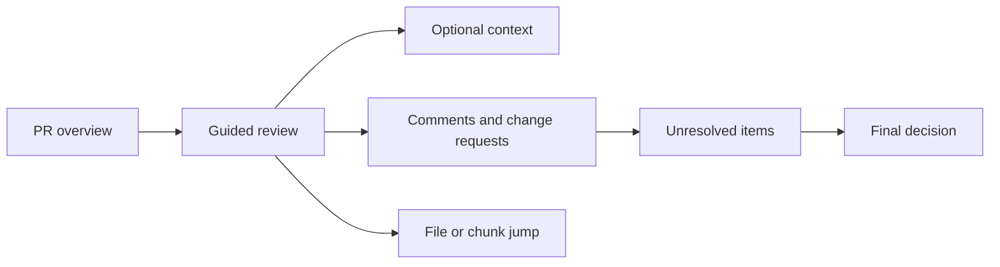

# Design note

## UI design

### PR review

The review experience is a guided terminal UI. It explains the intent of a
pull request before showing its implementation, then presents the changes in
small, meaningful units.

The design follows four principles:

- Explain intent before mechanics.
- Keep each code view within one comfortable terminal viewport.
- Show supporting context only when it improves understanding.
- Order changes for comprehension, not merely by file path.

#### Review flow

The default path is linear: overview, review chunks, unresolved feedback, and
final decision. The user can jump to another file or chunk without losing
their place in the guided sequence.

#### 1. Overview

The first screen answers, “What does this PR do?” It contains:

- A one-sentence statement of intent.
- Three to five concise behavioral changes.
- Review scope, such as files changed and additions/deletions.
- New concepts or abstractions, only when the PR introduces them.
- A clear action to start the guided review.

When an illustration would make the change easier to understand, the overview
uses the smallest useful form:

- A before/after example for changed behavior or APIs.
- A short flow for changed control or data movement.
- A concrete input/output example for a new capability.

The illustration should clarify the change rather than repeat the summary.
Routine changes do not need one.

#### 2. Guided review

The review is divided into semantic chunks. A chunk groups edits that serve
one purpose, even when those edits cross file boundaries. Git hunks are source
material, not the unit presented to the user.

Chunks are ordered by comprehension dependency:

1. New concepts, types, or interfaces.
2. Code that consumes those definitions.
3. Integration and wiring.
4. Tests and supporting changes.

Each chunk contains:

- A short title that names its purpose.
- A lean “What this does” summary.
- An ordered sequence of blocks: prose that makes a point, and the few quoted
  lines that support it, alternating as often as the explanation needs.
- Its position in the review and review status.
- Feedback actions.

The summary describes observable intent and avoids narrating individual lines.
It should normally be one or two sentences.

Quoted source is framed by a gutter and labelled with its path and
presentation, so the reviewer never has to guess where Gewu's explanation ends
and the reviewed material begins. Code quotes carry their new-side file line
numbers.

The generated spec chooses the presentation that best supports review:

- Use a diff when removed-versus-added behavior matters. Added diff lines use a
  green background.
- Show syntax-highlighted added code without diff markers when reviewing a new
  implementation and the removed side adds no useful context.
- Render Markdown sections as documents rather than raw diffs.
- Summarize generated artifacts whose full contents are not useful to inspect.

##### Chunk size

A chunk is the unit the user comments on, so it is sized to be worth one
comment: closely related edits only, small enough that the reviewer reacts to
the whole thing rather than to a line buried inside it. It must fit one
terminal viewport without paging.

Generation holds chunks to a row budget measured against how the review UI
draws them at a reference width. The budget defaults to one modest viewport and
is carried in the review input, so a user who deliberately wants larger chunks
can raise it when starting the harness.

A chunk quotes spans of a hunk that the agent chose, not fragments a splitter
cut in advance. Where a view begins and ends belongs to the explanation: a
thirty-line hunk becomes as many views as the walkthrough needs, each introduced
by prose saying what to look for.

Views may overlap. Showing lines 1-25, then lines 10-50, repeats the middle on
purpose, because the reader needs the earlier context again to follow what
comes next. The rule is not that each line appears once — it is that the union
of everything shown covers the whole diff, so nothing goes unreviewed.

If one semantic unit is too large, it is split at a logical boundary. Split
chunks retain a shared title and show their relationship, for example:

> Request validation · 1 of 2

Splitting must not separate a definition from the minimum context needed to
understand it. Unrelated edits must not be combined merely to fill the
viewport.

##### Refactors

When a chunk is primarily a refactor, its summary states:

- What structure changed.
- Why the change was made.
- Whether behavior is intended to remain unchanged.

A small before/after representation may be shown when it communicates the
structural change more clearly than prose.

#### 3. Context pane

A right-side context pane appears only when the current chunk benefits from
supporting information. When absent, the diff uses the full available width.

For a new or potentially unfamiliar concept, the pane shows:

- A brief definition in the context of this PR.
- A minimal example.
- Its relationship to the current chunk.

For a refactor, the pane may show:

- The previous structure.
- The new structure.
- The reason for the transition.

The pane is a snapshot, not full documentation. It must not duplicate the
chunk summary or force the user to read it before understanding the diff.

On terminals too narrow for a useful split view, context opens as a temporary
full-width panel and returns the user to the same diff position when closed.

#### 4. Navigation

The primary controls move to the previous or next chunk. The UI also provides:

- Overall progress and the current chunk position.
- A file and chunk navigator for non-linear review.
- Reviewed, unresolved, and unreviewed states.
- A visible relationship between parts of a split chunk.
- A way to return to the overview.

Jumping does not change the semantic review order or automatically mark
skipped chunks as reviewed.

#### 5. Feedback

For each chunk, the user can:

- Mark it reviewed.
- Add a non-blocking comment.
- Request a change, optionally attached to a specific line.
- Select one piece of feedback already left on the chunk, then reopen, resolve,
  or delete it.

Comments record context without blocking completion. Change requests remain
visible in the review progress and must be revisited before the final decision.
Line attachment is an advanced option inside the change-request flow rather
than a separate primary action.

Resolving and deleting act on a selected item, so they are offered only once
the user has picked one out rather than standing as chunk-wide actions.
Deleting withdraws feedback the user did not mean to leave; it is confirmed
first, and the event log still records that the feedback existed.

A help overlay, available with `?` on every screen, explains feedback semantics
and navigation. It closes with `?` or `Esc`.

Chunk review status and feedback status are independent: resolving a request
does not mark its chunk reviewed, and revisiting a reviewed chunk does not
resolve its requests.

After all chunks have been visited, the UI summarizes unresolved requests and
unreviewed chunks. The user can jump directly to each item, then complete the
review with one of:

- Approve.
- Comment.
- Request changes.

The UI warns about unresolved requests or unreviewed chunks but does not silently
discard them.

#### Content constraints and fallbacks

Generated explanations are supporting material and must never overwhelm the
code:

- Prefer concrete language tied to the displayed change.
- Keep overview bullets, chunk summaries, and context snapshots short.
- Do not invent motivation, behavior, or relationships that the diff and PR
  context do not support.
- Clearly label uncertain interpretations and allow the user to inspect the
  underlying edits.
- Omit empty sections and context panes instead of showing placeholders.
- Fall back to file-ordered Git hunks when semantic grouping cannot be
  produced reliably, and state that the fallback is active.

If no code changes are present, the overview explains what content is
available, such as documentation or metadata changes, and adapts the guided
review to those changes rather than showing an empty diff.

### Generation

A review is generated lazily, because review feedback changes code and code
changes invalidate reviews. Generating the whole review up front means paying
for explanations of work the reviewer is about to make obsolete.

The harness investigates the change set once, then plans a **work list**: an
ordered set of items, each a coherent part of the walkthrough, together
covering every line of the change set at least once. Only the topmost
unexpanded item is turned into chunks, which are appended to the review. Then
generation stops and the human reads.

Expansion of the next item resumes only when all of the following hold:

1. Every expanded chunk has been marked reviewed.
2. No change request is unresolved, unless the reviewer overrides.
3. The reviewer has not recorded a final decision.
4. Nothing has changed under the review beyond what is already expanded.

The first three are about the reviewer being ready. The fourth is about the
plan still being true: the harness re-diffs the tree and compares. A chunk
whose quoted code has moved is removed along with its reviewed status, because
an approval over code that has since changed is not an approval. If edits reach
work that was planned but not expanded, the remaining plan is discarded and the
uncovered remainder is investigated again — surviving chunks, and the feedback
on them, are kept.

This rests on identity: a change is identified by its file and its edited
lines, not by the commit it came from or where in the file it sits. An
untouched hunk therefore keeps its identity across a re-diff, which is what
lets completed review work survive an unrelated edit. For the same reason the
review a human is working through is identified by the run that created it, not
by the content of its spec, so appending chunks never orphans their progress.
